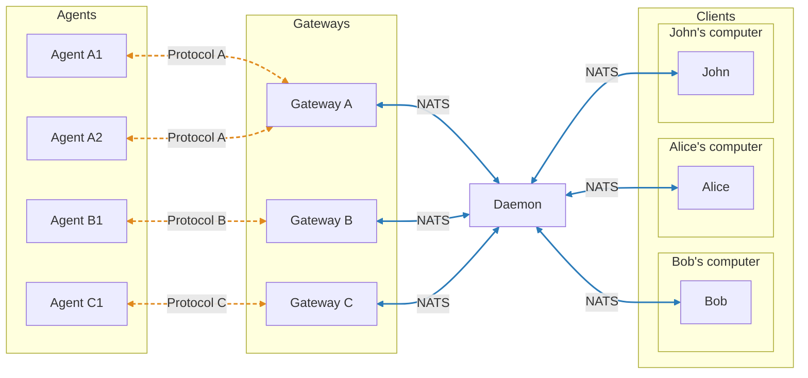

# Foojank

> [!NOTE]
> This README describes an upcoming release of Foojank that is still in development. See Releases for older versions.

## Overview

Foojank is a C2 framework designed for ethical hackers conducting red team and purple team engagements.
Built on top of [NATS](https://nats.io), Foojank is extensible, observable, and scalable.

### Features

* Command-line client interface that can be integrated in scripts and AI agents.
* Built-in data storage for payload distribution and data exfiltration.
* Multi-user support with configurable roles and privileges.
* Extensibility – support for custom protocols and third-party agents via Gateways.
* Observability – visibility into operator and agent activity and C2 messaging.
* Scalability – support for large-scale deployments with distributed architecture.

### Gateways

Gateways allow clients to communicate with agents using different protocols or third-party systems.

| Name                                                                    | Description                                                                                          | Status |
|-------------------------------------------------------------------------|------------------------------------------------------------------------------------------------------|--------|
| [Azure Queue Storage](https://github.com/foohq/foojank-azqueue-gateway) | Enables client-to-agent messaging over Azure Queue Storage for reliable, asynchronous communication. | WIP    |

### Agents

| Name                                      | Language | Platform               | Status |
|-------------------------------------------|----------|------------------------|--------|
| [Vessel](https://github.com/foohq/vessel) | Go       | Windows, Linux, Darwin | WIP    |

### Architecture

## Try it

TODO

## License

This software is distributed under the Apache License Version 2.0 found in the [LICENSE](./LICENSE) file.
